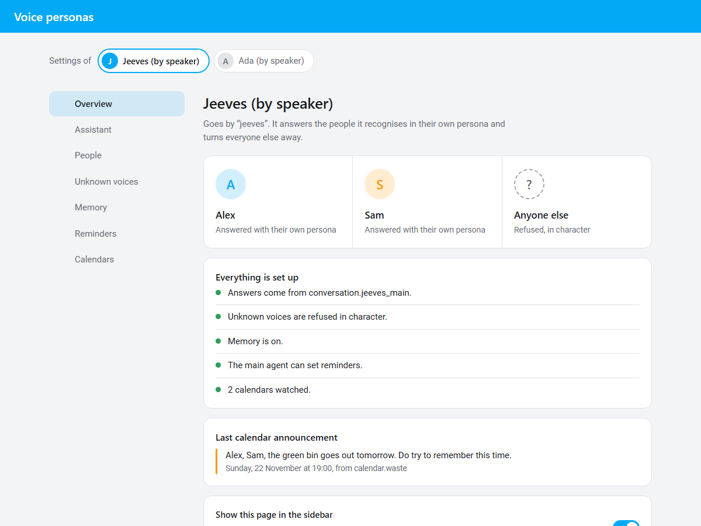
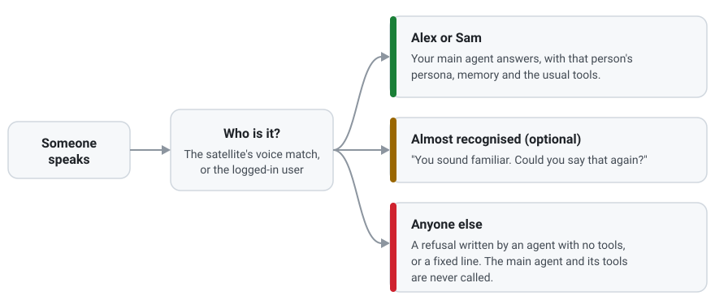
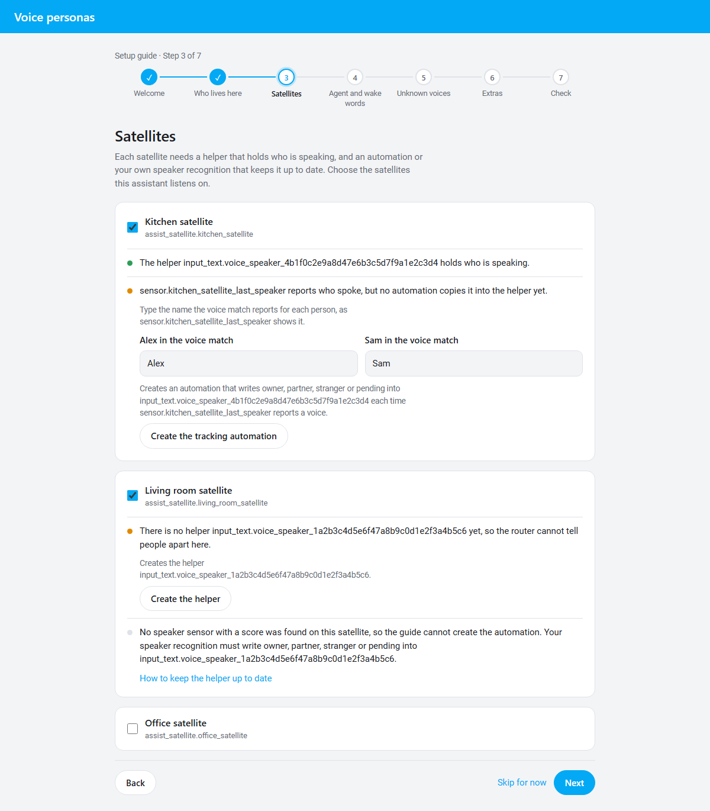
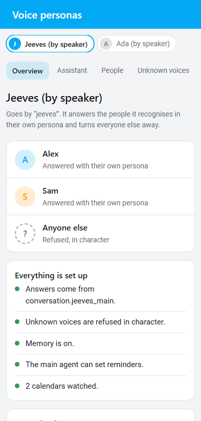
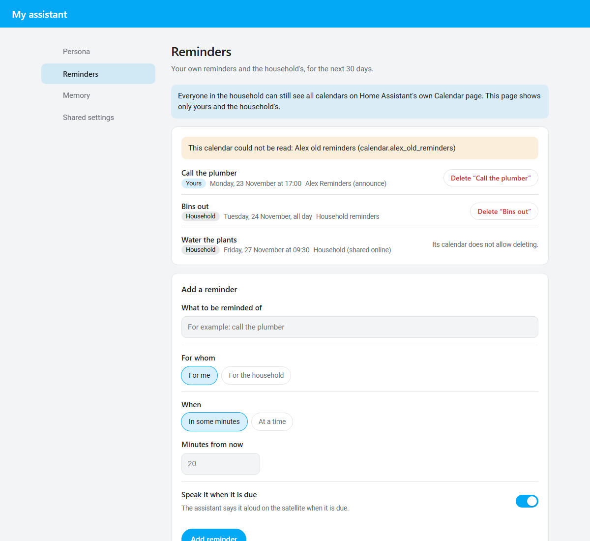

# Voice Assistant Manager

[](https://hacs.xyz/docs/faq/custom_repositories/)
[](https://github.com/rodavrow/ha-voice-assistant-manager/releases)
[](https://www.home-assistant.io/)
[](LICENSE)
[](https://ko-fi.com/R5O720EQBI)

By [rodavrow](https://github.com/rodavrow).

A Home Assistant custom integration that makes a voice assistant behave differently depending on who is speaking, and keeps unknown voices away from your devices.

It sits in front of a conversation agent you already have (any LLM agent) and looks up who is speaking before anything else happens.

<picture>
  <source media="(prefers-color-scheme: dark)" srcset="docs/images/settings-overview-dark.png">
  
</picture>

## What it does

- **A persona for each person.** Alex and Sam each get their own instructions added to the prompt, and their messages carry their name in the shared history, so the assistant can tell two people apart in one conversation.
- **Unknown voices are turned away.** Their request never reaches your main agent or any of its tools. The refusal comes from a second agent without tools, or from a list of fixed lines.
- **Near misses get a second chance.** Optionally, a voice that almost matched is asked to say it again.
- **Quick commands for the household only.** Home Assistant's built-in commands ("turn off the kitchen lights") run only for recognised speakers.
- **Memory.** Tell it something once and it still knows next week. Leave each other messages, or keep something private. See [Memory](docs/memory.md).
- **Reminders.** "Remind me" is set for the right person and spoken later by the same assistant, in its own style. See [Reminders](docs/reminders.md).
- **Calendar announcements.** The waste collection, birthdays or a family calendar, announced in the assistant's style and language, whatever language the calendar is in. See [Calendar announcements](docs/calendars.md).
- **Favorites.** "Play Radio 2" plays your own Radio 2 on the speaker you are talking to, instantly. Save stations, podcasts and playlists by voice or on the pages, for yourself or the household. See [Favorites](docs/favorites.md).
- **A chat show.** Two assistants talk to each other on a speaker, each in its own character and voice, and you can join in or tell them to stop. They can only talk. See [Chat show](docs/chat-show.md).
- **An avatar.** A face on a screen that moves its lips to what the assistant says, through a LiveTalking server. The satellite still speaks as before. See [Avatar](docs/avatar.md).
- **A page for each person.** Alex and Sam can manage their own persona, reminders and remembered facts without being administrators. See [My assistant](#my-assistant).
- **A settings page in the sidebar,** for everything above. There is no YAML to edit for the assistants themselves.

## Contents

- [How it works](#how-it-works)
- [What it looks like](#what-it-looks-like)
- [What you need](#what-you-need)
- [Install](#install)
- [Set up](#set-up)
- [The settings page](#the-settings-page)
- [My assistant](#my-assistant)
- [Favorites](docs/favorites.md)
- [Chat show](docs/chat-show.md)
- [Avatar](docs/avatar.md)
- [Documentation](#documentation)
- [Words used here](#words-used-here)
- [Privacy](#privacy)
- [Disclaimer](#disclaimer)
- [Support](#support)
- [License](#license)

The list of changes per version is in the [changelog](CHANGELOG.md).

## How it works



Each assistant is itself a conversation agent. You point Home Assistant's voice assistant (pipeline) at it, and it decides per request what happens. Who is speaking comes from a helper per satellite that your speaker recognition keeps up to date, or, for the phone app and the browser, from the Home Assistant user who is logged in.

### How unknown voices are kept away from your devices

- The main agent is never called for an unknown voice, so none of its tools can run.
- The refusal is written by a separate agent in a conversation of its own, with only the refusal instructions. Give that agent no tool providers.
- The exchange is removed from the shared history, so it cannot influence later answers.
- Built-in commands are only tried for Person 1 and Person 2.
- The fixed lines are never empty for an unknown voice. If you leave them blank, a plain "Sorry, I can't help you." is used.

The near-miss reply needs a sensor on the satellite's device whose entity id ends in `_last_speaker_score`.

## What it looks like

Say the household is Alex and Sam, and the assistant is set up as a dry butler.

Alex speaks, and is recognised:

> **Alex:** Turn the heating up a bit.
> **Assistant:** Done, Alex. Twenty-one degrees.

Sam speaks to the same satellite, and gets the persona written for Sam:

> **Sam:** What's on my calendar tomorrow?
> **Assistant:** Dentist at nine, I'm afraid.

A visitor tries it:

> **Visitor:** Turn off all the lights.
> **Assistant:** We have not been introduced, so the answer is no.

The visitor's request never reached the main agent or its tools, so nothing could be switched. The replies themselves come from your own agents and the texts you fill in, so yours will sound like your assistant, not like these.

> [!WARNING]
> **This is not a security control.** Voice matching can be fooled, and some routes into Home Assistant bypass the assistant (see [Limits](docs/limits.md)). Treat it as a way to give each person their own assistant personality and to keep guests from switching your lights off for fun, not as a lock.

## What you need

- **Home Assistant 2026.11 or newer.** It has only been tested on 2026.11.2. Older versions are missing parts of the conversation history API this integration uses.
- **A voice satellite that can tell who is speaking.** Voice Assistant Manager does not do speaker recognition itself. It reads a helper that you keep up to date with an automation (an example is included).
- **A conversation agent** to answer the people who live here, set up the way you like it.
- **A second conversation agent with no tools**, if you want refusals written by an AI. It must have no access to Assist or any other tool provider. Saving is refused if it can control the home, and a setup that already has such an agent sees the error on its next save. Fixed lines need no second agent.
- **A cheap conversation agent with no tools**, if you want [memory](docs/memory.md). It decides what is worth remembering after each reply.
- **A reminder script in Home Assistant**, if you want [reminders](docs/reminders.md). Voice Assistant Manager does not store reminders itself.

> [!TIP]
> Have an old Amazon Echo Dot or Echo Show lying around? Check out the excellent [EchoLocal](https://github.com/ygelfand/echolocal) project. It turns supported Echo devices into local Home Assistant voice satellites with voice match (who's speaking). Voice Assistant Manager was built and tested on EchoLocal satellites, and the [example automation](examples/speaker_tracking_automation.yaml) is written for the "last speaker" and "last speaker score" sensors that EchoLocal's voice match provides.

## Install

### With HACS

1. In HACS, open the menu and choose **Custom repositories**.
2. Add the address of this repository with the type **Integration**.
3. Find **Voice Assistant Manager** in HACS and download it.
4. Restart Home Assistant.

### By hand

1. Copy the `custom_components/voice_assistant_manager` folder into the `custom_components` folder of your Home Assistant configuration.
2. Restart Home Assistant.

## Set up

### Add an assistant

1. Go to **Settings > Devices & services > Add integration** and pick **Voice Assistant Manager**.
2. Give it a name, for example `Kitchen assistant (by speaker)`, and choose your main agent.

This creates a new conversation agent with that name. Add the integration once for each assistant personality you want.

### Run the setup guide

Open **Voice Manager** in the sidebar. An assistant that was never saved opens the setup guide at once. It walks through seven steps: welcome, who lives here, satellites, agent and wake words, unknown voices, extras and a final check.



The guide does what steps 1 to 4 of [Setting it up by hand](#setting-it-up-by-hand) do: the helper, the tracking automation, the settings and the voice assistant pipeline. Each change happens after a click on a button that says what it will do, and nothing in your Home Assistant changes before that.

- **Who lives here** gives Alex and Sam a name and a ready-made style: Dry butler, Friendly, or Short and plain.
- **Satellites** creates the helper for each satellite you choose. For a satellite with both a `_last_speaker` and a `_last_speaker_score` sensor it also creates the tracking automation, named `voice_assistant_manager_speaker_<device id>`. For any other satellite, your speaker recognition has to write the helper (see step 2 of [Setting it up by hand](#setting-it-up-by-hand)).
- **Agent and wake words** switches off "Prefer handling commands locally" on this assistant's pipeline, or makes a copy of the pipeline of a wake word for this assistant and puts it on that wake word. It never changes another agent's pipeline, or the preferred pipeline of another agent, and it refuses when two pipelines have the same name.

You can leave the guide with **Skip for now**. It resumes where you left it, and the Overview shows a **Finish setting up** banner until it is done. To run it again, use **Run the setup guide again** on the Overview.

> [!NOTE]
> The guide does not set up your speaker recognition, and it does not create the reminder script. See [Reminders](docs/reminders.md) for that.

### Setting it up by hand

The same things can be done without the guide. These steps are the reference for what the guide creates, and the way to go for a satellite it cannot handle.

#### 1. Create one helper per satellite

The assistant looks for a text helper named after the **device id** of the satellite the request came from:

```
input_text.voice_speaker_<device id>
```

To find the device id, paste this into **Developer tools > Template**, with your own satellite entity:

```
{{ device_id('assist_satellite.kitchen_satellite') }}
```

Then create a **Text** helper (Settings > Devices & services > Helpers) and name it `voice speaker <device id>`, so that its entity id becomes `input_text.voice_speaker_<device id>`.

The helper holds one of these values:

| Value | Meaning |
| --- | --- |
| `owner` | Person 1 in the assistant's settings |
| `partner` | Person 2 in the assistant's settings |
| `stranger` | Anybody else |
| `pending` | The wake word was heard and the voice match has not arrived yet |
| anything else, or empty | Treated as an unknown voice, so a helper that is not kept up to date refuses instead of answering |

#### 2. Keep the helper up to date

[`examples/speaker_tracking_automation.yaml`](examples/speaker_tracking_automation.yaml) is an automation that does this for satellites which expose a "last speaker" sensor and a "last speaker score" sensor. When the satellite starts listening it writes `pending`. When the voice match arrives it writes the role.

A follow-up question in the same conversation, which a satellite asks without a wake word and usually without a new voice match, keeps the person of the turn before: on the same satellite, within a minute of that turn. A new voice match still decides: the other person switches, an unknown voice is refused. This does not depend on the satellite's timing.

Change the entity ids and the two names in it to match your setup. If your speaker recognition reports its result in another way, write the same four values into the helper by whatever means you have.

#### 3. Fill in the settings

Open the new entry and choose **Configure**, then **Settings**. See [Settings](docs/settings.md).

#### 4. Point your voice assistant pipeline at the assistant

1. Go to **Settings > Voice assistants** and open the voice assistant (pipeline) your satellite uses.
2. Set **Conversation agent** to the assistant you just added.
3. Switch **Prefer handling commands locally** off.

> [!IMPORTANT]
> The last step matters. With that option on, Home Assistant runs its built-in commands before the assistant is asked anything, so an unknown voice could still switch things on and off. With it off, the assistant tries the built-in commands itself, and only for a recognised speaker.

### Phone app and browser

The phone app, the Assist chat window in the browser and other devices without a helper cannot match a voice. They do send the Home Assistant user who is logged in, so choose each person's **Home Assistant user** in the settings. For a request that carries a logged-in user, the assistant then works it out like this:

1. Logged in as the user chosen for Person 1 or Person 2: that person.
2. Logged in as any other user, once at least one person has a user chosen: an unknown voice, so a guest account gets a refusal.
3. No users chosen in the settings: whatever "A device without speaker recognition is" says.

A typed request always goes by who is logged in, even when it names a satellite. Home Assistant lets any logged-in user send text as if from any device, and a satellite's helper still holds the last voice it matched, so the helper is never used for a request that carries a user. Voice requests from a satellite carry no user and are decided by its helper. A request with no user and no helper (an automation, say) gets whatever "A device without speaker recognition is" says.

## The settings page

After installing, the sidebar has a **Voice Manager** entry. It opens a page with everything about your assistants in one place:

- **Overview** shows who the assistant knows, how each voice is answered, and anything that needs attention, such as an agent that no longer exists or calendars without a script to speak them. It also shows the last calendar event that was announced.
- **Satellites and pipelines** are checked too. The Overview says when a satellite has no helper, when its speaker sensors are not copied into the helper by any automation, and when a pipeline that uses the assistant still prefers handling commands locally. Each has a button that fixes it, after a click, or opens the setup guide at the right step.
- **Assistant**, **People**, **Unknown voices**, **Memory**, **Reminders** and **Calendars** hold the same settings as the Configure dialog, grouped by what they are about. Change something and a bar appears to save or discard it.
- **Memory** lists what is remembered. Add a fact, forget one, or switch a fact between shared and private. These changes are saved at once.
- **Calendars** lists the calendars that are watched, with a form to add, change or remove one.

The first time you open the page for an assistant that was never saved, the [setup guide](#run-the-setup-guide) opens instead. **Run the setup guide again** on the Overview opens it later.

The page shows one assistant at a time. With more than one, a row of buttons at the top of the page, one per assistant, switches between them. Every section below it, including Overview and Assistant, then shows that assistant.

The page is for administrators only. It follows your Home Assistant theme, including dark mode, and works on a phone.



To take it out of the sidebar, turn off **Show this page in the sidebar** at the bottom of the Overview. The page stays reachable at `/voice-assistant-manager`, where you can turn it back on.

The Configure dialog (**Settings > Devices & services > Voice Assistant Manager > Configure**) still works and saves the same settings. [Settings](docs/settings.md) describes each setting, whichever of the two you use.

## My assistant

**My assistant** is a second sidebar entry, for every logged-in user, not only administrators. It lets Alex and Sam look after their own part of an assistant. The **Voice Manager** page stays for administrators and does not change.



Who someone is comes from the Home Assistant user they are logged in as, checked on the server. An assistant counts someone as Person 1 or Person 2 when that person's **Home Assistant user** is chosen under People in its settings. With more than one assistant, a row of buttons switches between the ones the user is linked to. A user who is linked to none sees a line asking them to tell an administrator.

For each assistant they are linked to, a user can:

- **Persona.** Read and change their own persona, up to 2000 characters.
- **Reminders.** See their own and the household's reminders for the next 30 days, add one, and delete one. A reminder is added for "me" or "the household", with "Speak it when it is due" on by default, in some minutes or at a time and day. It is set through the assistant's `script.create_reminder` (see [Reminders](docs/reminders.md#my-assistant)). When that script does not exist, the form says so instead.
- **Memory.** See and edit what the assistant remembers about them, from this assistant's list and from the list for all assistants, private facts included: add one, forget one, or switch it between shared and private. The list for all assistants only appears when that person is the same Person 1 (or Person 2) in every assistant that has a Home Assistant user chosen for that place.
- **Favorites.** See and change their own favorites and the household's: find a station, podcast or playlist with Music Assistant, add a stream address, change a name or its other names, or remove one. While favorites are off for all of their assistants, only a notice is shown, without the household's list either. See [Favorites](docs/favorites.md#manage-favorites-on-the-pages).
- **Shared settings.** Read the assistant name, how unknown voices are answered, and the calendars announced for them or for everyone. These are changed on the Voice Manager page.

They never see or change the other person's persona, remembered facts or reminders.

An administrator decides where reminders are kept, under **Reminders** in the settings: **Reminder calendars of Person 1**, **of Person 2** and **of the household**. A personal calendar may belong to one Home Assistant user only, across all assistants, and may not also be a household calendar. A personal list needs that person's Home Assistant user. See [Settings](docs/settings.md#reminders).

> [!IMPORTANT]
> **Home Assistant has no access control per user for calendars.** Every logged-in user can still read every calendar on Home Assistant's own Calendar page, and on any dashboard that shows one. My assistant only shows each person their own reminders and the household's. It does not hide anything from someone who opens another page. Remembered facts are different: Voice Assistant Manager stores them and they can only be reached through it, so private facts stay private.

## Documentation

| Page | What is in it |
| --- | --- |
| [Settings](docs/settings.md) | Every setting, section by section, and example texts for personas and refusals. |
| [My assistant](#my-assistant) | What Alex and Sam can do on their own page, and where it stops. |
| [Memory](docs/memory.md) | What you can say, who knows what, private facts, and editing what is remembered. |
| [Reminders](docs/reminders.md) | What Voice Assistant Manager adds to reminders, and what Home Assistant has to provide. |
| [Calendar announcements](docs/calendars.md) | Adding a calendar, steering the style of the line, and what your script receives. |
| [More assistants than wake-word slots](docs/multiple-assistants.md) | Having more assistants than your satellites have wake words. |
| [Favorites](docs/favorites.md) | Playing stations, podcasts and playlists by name, saving them by voice, whose list and which speaker, and the limits. |
| [Chat show](docs/chat-show.md) | Two assistants talking to each other on a speaker, with characters, voices, limits and joining in. |
| [Avatar](docs/avatar.md) | A lip-sync avatar for an assistant: how the speech is copied, switching engines, and the limits. |
| [Limits](docs/limits.md) | What Voice Assistant Manager does not do, and where it can be bypassed. |
| [Troubleshooting](docs/troubleshooting.md) | Common problems and their likely causes. |
| [Contributing](CONTRIBUTING.md) | Running the tests. |

Ready-made examples are in [`examples/`](examples/):

- [`speaker_tracking_automation.yaml`](examples/speaker_tracking_automation.yaml) keeps the helper of each satellite up to date.
- [`create_reminder.yaml`](examples/create_reminder.yaml) is a `create_reminder` script for [reminders](docs/reminders.md).
- [`calendar_announce.yaml`](examples/calendar_announce.yaml) is a script that speaks [calendar announcements](docs/calendars.md).

## Words used here

| Word | Meaning |
| --- | --- |
| Assistant | One entry of this integration, with its own name and personality. It is a conversation agent that sits in front of your main agent. |
| Voice assistant pipeline | Home Assistant's own voice assistant (Settings > Voice assistants): a wake word, speech to text, text to speech, and the conversation agent it passes requests to, such as one of the assistants. |
| Assistant name | The lower-case name an assistant goes by in reminders and calendar announcements, such as `jeeves`. |
| Satellite | A device with a microphone and a speaker that people talk to. |
| Helper | The text helper per satellite that holds who is speaking: `owner`, `partner`, `stranger` or `pending`. |
| Person 1, Person 2 | The two people who live here, as named in the settings. Person 1 is `owner` in the helper, Person 2 is `partner`. |
| Household | Both of them, for reminders and calendars. |
| Persona | Instructions added to the main agent's prompt when a given person speaks. |
| Main agent | Your own conversation agent, with its tools. It answers Person 1 and Person 2. |
| Refusal agent | A conversation agent without tools that writes the refusal for an unknown voice. |
| Memory agent | A cheap conversation agent without tools that decides what is worth remembering. |
| Announcement agent | A conversation agent without tools that writes spoken reminders and calendar lines. |

## Privacy

Voice Assistant Manager sends nothing anywhere by itself. It has no telemetry, no analytics and no network calls of its own. All the same, it does handle what people say, so here is where that goes:

- **Your conversation agents.** The words spoken, plus the persona and history-rule text from your settings, are passed to the main agent and the refusal agent you picked. If either one is a cloud LLM, that text leaves your network under that provider's terms. Voice Assistant Manager has no control over what they keep.
- **Settings.** Names, personas, instructions and fixed lines are saved in Home Assistant's own configuration storage (`.storage/core.config_entries`), the same place as every other integration's settings.
- **Shared history.** Messages from Person 1 and Person 2 stay in Home Assistant's conversation history with their name in front, the same as with any other agent. Exchanges with unknown voices are removed from it.
- **Logs.** With debug logging on, the integration writes the text of each spoken request to the Home Assistant log. Turn debug logging off again when you are done, and check the log before you share it in a bug report.
- **Home Assistant users.** If you choose a user for Person 1 or Person 2, the assistant stores that user's internal id in its settings and compares it with the user behind each request. Nothing about the user is sent anywhere.
- **Memory between people.** With sharing on (the default), what one person tells the assistant is used when the other person speaks, unless they asked to keep it private. Tell the people in your home that this is how it works.
- **Memory.** With memory on, each exchange with a recognised person (their words and the assistant's reply), together with what is already remembered about them, is sent to the memory agent you chose. If that is a cloud LLM, it leaves your network under that provider's terms. The remembered facts are stored unencrypted in `.storage/voice_assistant_manager.memory` and are included in Home Assistant backups. With debug logging on, saved and removed facts are written to the log.
- **Reminders.** Voice Assistant Manager stores no reminders. With reminders on, the main agent is told the names of Person 1 and Person 2 so it can set a reminder for the right one. The `compose_announcement` action sends the reminder text, the recipient's name and the persona text written for them to the announcement agent. If that is a cloud LLM, it leaves your network under that provider's terms.
- **Calendars.** For a calendar you list, the assistant reads its events once a minute. When one is due, its title and time, the name of who it is for, the persona text written for them and your description of the calendar are sent to the announcement agent. If that is a cloud LLM, it leaves your network under that provider's terms. The assistant keeps a short note of which events it announced in `.storage/voice_assistant_manager.calendars.<id>`, with their titles, for about a day.
- **Voice data.** Voice Assistant Manager never sees audio or voiceprints. Speaker recognition happens on your satellite. It only reads the role (`owner`, `partner`, `stranger`, `pending`) from your helper and, for near misses, the score sensor.

Tell the people in your home, and your guests, that the assistant recognises voices and, if you use a cloud agent, that what they say may be sent to it.

## Disclaimer

- This is an independent community project. It is not affiliated with, endorsed by or supported by Home Assistant, the Open Home Foundation or Nabu Casa, or any voice hardware or AI provider.
- **It is not a security control.** Do not rely on it to protect locks, alarms, garage doors, cameras or anything else where a wrong decision could cause harm or a loss. Voice recognition can be fooled or get it wrong, and some routes bypass the assistant entirely (see [Limits](docs/limits.md)).
- Replies come from AI models that can be wrong, rude or unpredictable. You are responsible for the agents you connect, the instructions you give them and what they do in your home.
- You are responsible for following the privacy and recording laws where you live, including getting consent from anyone whose voice is recognised.
- The software is provided without any warranty, to the extent permitted by law. See [LICENSE](LICENSE).

## Support

If this is useful to you, you can buy me a coffee:

[](https://ko-fi.com/R5O720EQBI)

Bug reports and feature requests go to the [issue tracker](https://github.com/rodavrow/ha-voice-assistant-manager/issues). Donations are entirely optional and do not buy priority support.

## License

Copyright © 2026 rodavrow

Voice Assistant Manager is free software: you can redistribute it and/or modify it under the terms of the [GNU Affero General Public License](LICENSE) as published by the Free Software Foundation, either version 3 of the License, or (at your option) any later version (`AGPL-3.0-or-later`).

In short: you may use, change and share it. If you share a changed version, or let other people use a changed version over a network, you have to offer them its source code under the same licence.
