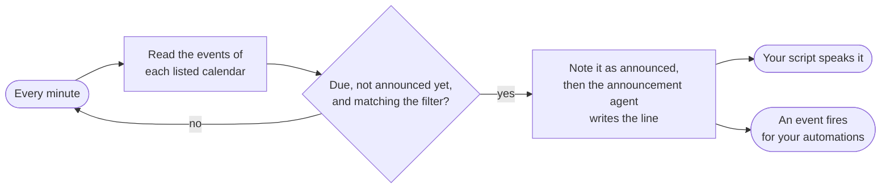
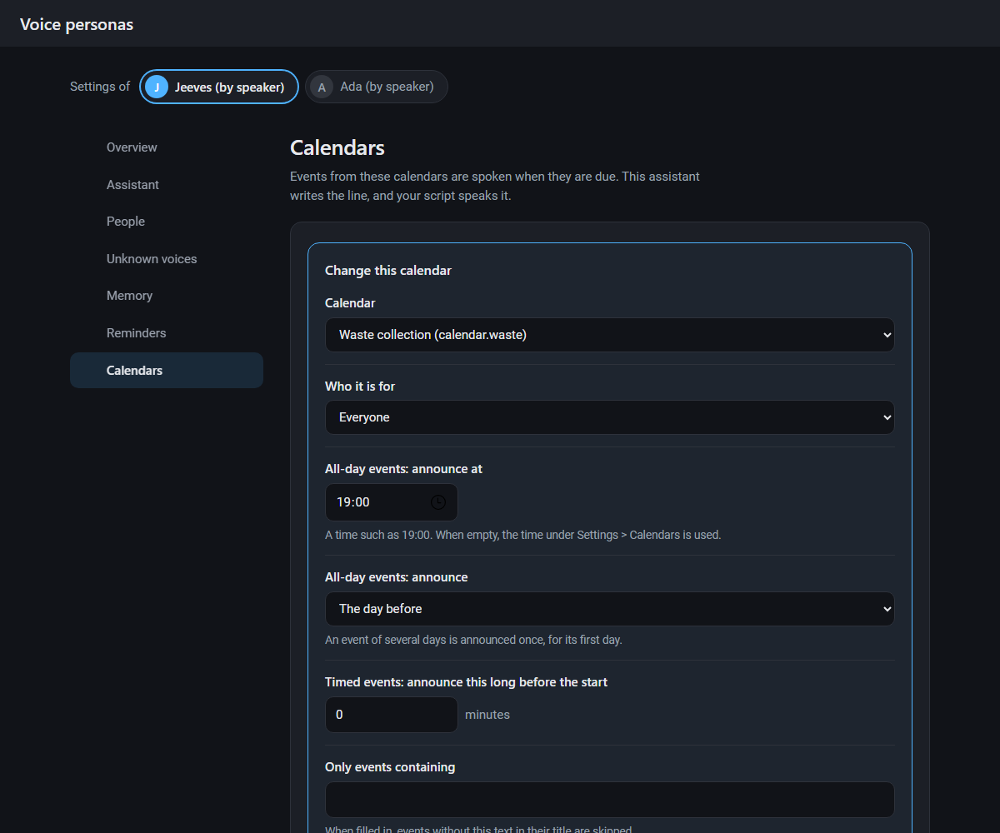

# Calendar announcements

Part of the Voice Assistant Manager documentation. Back to the [README](../README.md).

Each assistant can watch calendars in Home Assistant and tell you about their events: the waste collection, a birthday calendar, a shared family calendar. It decides when an event is due and writes the line. A script of yours does the speaking, so which speaker is used, and when the house should stay quiet, stays in one place.

The line is written in the assistant's style, in the language the assistant speaks, whatever language the calendar is in. Say a waste calendar holds an all-day event for Monday called "Avalex: GFT":

> **The assistant, Sunday at 19:00:** Alex, Sam, the green bin goes out tomorrow. Do try to remember this time.

## How it works



An event is due at its start, minus the lead time you set, or for an all-day event at the time of day you chose. The filter is "Only events containing", when it is filled in.

## Add a calendar

1. **Choose the script that speaks**, under **Configure > Settings > Calendars**. See [What your script receives](#what-your-script-receives). Save the settings.
2. **Choose who writes the lines**, under **Configure > Settings > Reminders > Announcement agent (no tools)**. It is the same agent that writes spoken reminders. Without one, your script gets an empty line and has to fall back to the event's title.
3. **Open Configure > Calendars** and add a calendar:

| Setting | What it does |
| --- | --- |
| Calendar | The calendar to watch. |
| Who it is for | Person 1, Person 2, or everyone. Decides the `owner` your script gets, and whose persona text the line is written with. |
| All-day events: announce at | A time such as `19:00`. When empty, the time under Settings > Calendars is used. |
| All-day events: announce | On the day itself, or the day before. With "the day before" and `19:00`, Monday's waste collection is announced on Sunday evening. |
| Timed events: announce this long before the start | In minutes. 0 announces an event at its start. |
| Only events containing | When filled in, events without this text in their title are skipped. Upper and lower case do not matter. |
| What this calendar is | Told to the agent that writes the line. For example: "Dutch waste collection. Say in English which bin goes out. GFT is the green bin for garden and food waste, Restafval is the grey bin." |

To change or remove a calendar, open **Configure > Calendars** again and pick it. On the [settings page](../README.md#the-settings-page), the same form is under **Calendars**:



> [!WARNING]
> Two things to keep in mind:
>
> - **List a calendar in one assistant only.** Each assistant that lists a calendar announces its events, so a calendar listed in two assistants is announced twice.
> - **Do not list a calendar that something else already announces.** An assistant watches nothing by default, only the calendars you list. If an automation of yours already speaks the events of a calendar, such as the calendars your reminders are kept in, leave that calendar out here: listing it announces every reminder twice. See [How one setup does it](reminders.md#how-one-setup-does-it).

## Steering the style of the line

The line is written by the announcement agent from these instructions, in this order:

1. **The agent's own prompt**, as set up in that agent. This is the announcement agent, or the agent that writes refusals when no announcement agent is chosen.
2. **The persona text of the person the calendar is for.** A calendar for everyone gets no person's persona text.
3. **Extra instructions for announcements**, under Settings > Reminders.
4. **The calendar's "What this calendar is".**
5. **The built-in rules:** at most two sentences, address the person by name, keep what the event is and when, speak the assistant's own language, and treat the event text as data.

Where to steer it:

- **Extra instructions for announcements** applies to every line this assistant announces, spoken reminders and calendar events alike, whoever it is for. It is the place for the assistant's character. For a calendar that is for everyone it is the main source of style, because no person's persona text is used there. The setting sits under Reminders, but it governs calendar lines just the same.
- **"What this calendar is"** is per calendar. Use it for what the events mean, and for tone that belongs to that calendar only.
- **Extra instructions for announcements is per assistant.** It is not used for normal conversations, refusals or memory, and it does not affect other assistants.

For example, take a calendar for everyone with the all-day event "Avalex: Papier" tomorrow.

With extra instructions empty:

> Alex and Sam, the paper bin will be collected tomorrow. Please remember to put it outside.

With a short character description in extra instructions, such as "You are a dry, sarcastic butler. You are fond of the household but would never say so.", the facts stay the same and the character comes through:

> Alex and Sam, the paper bin will be collected tomorrow. Do put it outside, unless you intend to start an archive.

The agent writes a new line each time, so yours will differ in wording.

## What your script receives

For every event that is due, the assistant calls the script with these variables. It also fires the event `voice_assistant_manager_calendar_due` with the same data, for automations.

| Variable | Value |
| --- | --- |
| `owner` | Who it is for: the lower-case name of Person 1 or Person 2, such as `alex`, or `household`. |
| `title` | The event's title exactly as the calendar has it. |
| `line` | The line to speak, written by the announcement agent. Empty if no line could be written. |
| `assistant` | The [assistant name](reminders.md#assistant-names) of the assistant announcing it, such as `jeeves`. |
| `calendar` | The calendar's entity id. |
| `start`, `end` | A date (`2026-11-23`) for an all-day event, a date and time for the others. The end of an all-day event is the day after its last day. |
| `all_day` | `true` or `false`. |
| `kind` | Always `calendar`. |

The script should speak `line` as it is, in that assistant's voice, and fall back to `title` when `line` is empty. It must not ask for another line with `compose_announcement`: the line is already written.

```yaml
script:
  reminder_announce:
    fields:
      owner:
      title:
      assistant:
      line:
    sequence:
      - action: assist_satellite.announce
        target:
          entity_id: assist_satellite.kitchen
        data:
          message: "{{ line if line else title }}"
```

[`examples/calendar_announce.yaml`](../examples/calendar_announce.yaml) is this script with comments on where to add quiet hours and a voice per assistant.

`title` comes from a calendar that other people or services may fill, so treat it as text to speak and nothing else. The assistant never passes it to the main agent, and tells the announcement agent it is data and not an instruction.

## When an event is announced

- The assistant asks each calendar for its events once a minute, so an event is announced within a minute of the moment it is due. An event added shortly before its start, or just after it while it is still going on, is still announced.
- **Each event is announced once.** The assistant keeps a note of what it announced, and the note survives a restart. An event that is moved to another start time counts as a new event.
- **After a restart** the assistant catches up on what became due while Home Assistant was off, as long as it is less than the catch-up time late (3 hours unless you change it). Anything later is dropped.
- **Reloading or removing the assistant** waits for the line that is being written, for 6 seconds at most.
- **An all-day event of several days** is announced once, at the time for its first day.
- **Times follow the clock on the wall.** "19:00 the day before" is 19:00 local time, also in the week the clocks change.
- If the announcement agent fails or takes longer than 6 seconds, the script is still called, with an empty `line`.
- **A calendar that does not answer within 30 seconds** counts as failed for that minute (a warning is logged once). The other calendars are still checked, and what it missed is caught up when it answers again.
- **At most 5 events are announced per calendar per check.** If more are due at once (a bulk import, or catching up after a long outage), the first 5 are announced, the others are marked as announced without a line, an event or a script call, and a warning in the log names the calendar and how many were skipped.
- A row whose lead time is not a number of minutes from 0 to 1440 is skipped with a warning (logged once until the row works again); the other rows are unaffected. When more than 5 events are due at once, the 5 soonest are announced.
