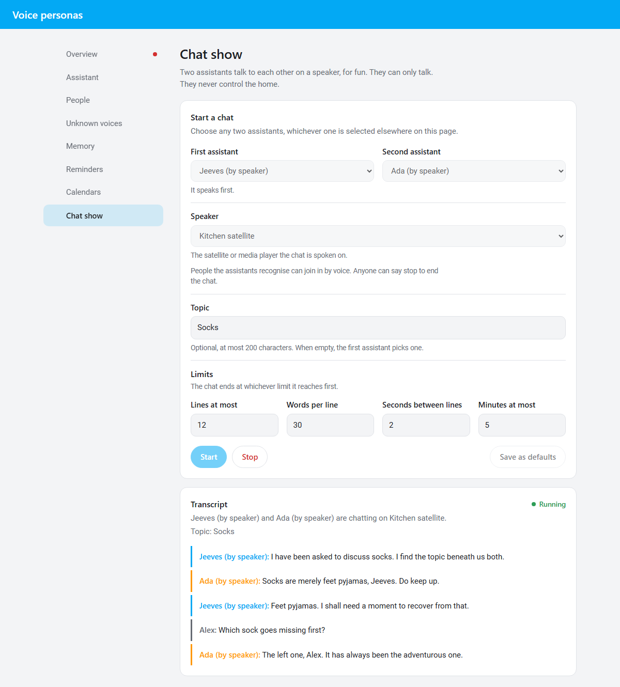

# Chat show

Part of the Voice Assistant Manager documentation. Back to the [README](../README.md).

Two of your assistants talk to each other on a speaker, for fun. Each one keeps its own character and its own voice. People in the room can join in, or tell them to stop.



> [!NOTE]
> The assistants can only talk. The lines are written by each assistant's announcement agent, which has no tools. The main agent, memory, reminders and the state of your home are never used.

## What you need

- **Two assistants** of this integration. Each needs an announcement agent without tools, chosen under **Reminders** in its settings. See [Settings](settings.md#reminders).
- **A speaker.** A voice satellite that can announce, or any media player that can play media.
- **An administrator.** The Chat show is on the Voice Manager page, which is for administrators only.

## Starting a chat

1. Open **Voice Manager** in the sidebar and go to **Chat show**.
2. Choose the **First assistant** (it speaks first), the **Second assistant** and the **Speaker**.
3. Type a **Topic**, for example `Socks`, or leave it empty. The first assistant then picks one. A topic is at most 200 characters.
4. Check the limits, then press **Start**.

The transcript fills in while the chat runs. **Stop** ends it, but lets a line that is playing finish first; the card says so until it has. When the chat has ended, the card says why.

Only one chat runs at a time. The chat is kept in memory only: it ends when Home Assistant restarts or one of the two assistants is reloaded, and the transcript is gone after that.

You can also start and stop a chat from a script or a dashboard button. See [Actions](#actions).

## Giving each assistant a character

Open the **Assistant** section and look for **Chat show**. Each assistant has two settings there.

| Setting | What it does |
| --- | --- |
| Character for chats | How this assistant behaves in a chat, up to 2000 characters. When empty, **Extra instructions for announcements** is used. When both are empty, the card warns that the assistant will sound plain. |
| Voice for chats | A text-to-speech engine and, optionally, a voice. When empty, the chat is spoken in the speaker's own voice. |

Two assistants may share one announcement agent. The character is what makes them sound different.

A good start is to copy the personality part of your main agent's prompt into **Character for chats**. Leave out everything about controlling the home, devices and tools. The announcement agent has no tools, so those lines would only confuse it.

Example for Jeeves:

> You are Jeeves, a dry, put-upon butler. You are polite, a little weary and never rude. You think very little of Ada's ideas, and say so gently.

Example for Ada:

> You are Ada, a cheerful and curious assistant. You love silly questions and you tease Jeeves kindly.

## Voices

- **A satellite** plays each line as an announcement, in the assistant's chat voice, or in the satellite's own voice when none is set.
- **A media player** plays the line as text to speech. When an assistant has no chat voice, Home Assistant's default text-to-speech engine is used.

## Limits

The chat ends at whichever limit it reaches first.

| Limit | Default | Range |
| --- | --- | --- |
| Lines at most | 12 | 2 to 50 |
| Words per line | 30 | 5 to 80 |
| Seconds between lines | 2 | 0 to 10 |
| Minutes at most | 5 | 1 to 30 |

The words limit is a hard maximum: the assistants are asked for a little under it, and a line that still runs over is cut back to its last complete sentence.

**Save as defaults** keeps the values on the card for the next chat.

On a satellite that supports it, **Listen after each round (best effort)** makes the satellite listen after the second assistant's line, so someone can join in without waking it first. The chat goes on if nobody speaks. The last line of a chat never listens. Listening is only offered on a satellite whose first wake word uses an assistant, so a reply always reaches an assistant and never your main agent. Not every satellite or voice pipeline supports this, and it is not offered for the others.

A line the satellite listens after stays in that satellite's conversation in Home Assistant, which the satellite keeps using until it has been idle for five minutes. The assistant therefore gives your main agent a conversation of its own for requests in that conversation, so the main agent never sees a chat line. This only works for requests that reach an assistant. **Do not use listening on a satellite whose second wake word uses an agent that is not an assistant** (for example your main agent directly): a request through that wake word would carry the chat lines to that agent, and no assistant can step in.

## Joining in and stopping

This works on a **satellite** whose wake word uses any assistant. It does not need to be one of the two in the chat. On a media player, the chat is listen-only: stop it from the card.

| Who | What they say | What happens |
| --- | --- | --- |
| Alex or Sam (recognised) | Anything | It becomes a line in the chat, with their name. The assistants answer it next. The satellite says "Mm-hm." |
| Anyone, including an unknown voice | `stop`, `enough`, `quiet`, `that's enough`, `be quiet`, `shut up` or `end the chat`, alone or at the start of what they say | The chat ends. The satellite says "Okay." |
| An unknown voice | Anything else | Refused, as usual. The chat goes on. |

While a chat runs on a satellite, a voice the assistant cannot identify is refused.

The assistants say each other's names, so the satellite may wake on its own line when a name is its wake word. The assistant ignores what the satellite hears then (it answers with nothing) and the chat goes on with the next line. To join in or say stop, wait until a line has ended and wake the satellite between lines.

A line that is playing is never cut off. If the satellite is busy because someone woke it, the chat waits for it, and ends if it stays busy.

What people say while joining in is only used in the chat. It never reaches the main agent, memory or the shared history. This also holds for about a quarter of a minute after the chat ended, while the satellite may still be listening: a late reply gets "Mm-hm." and a late stop word gets "Okay.".

## Why a chat ended

| Shown on the card | Meaning |
| --- | --- |
| The chat reached its line limit. | It did as many lines as you allowed. |
| The chat reached its time limit. | It ran for the minutes you allowed. |
| The chat was stopped. | Someone pressed **Stop**, called `stop_chat` or said a stop word. |
| An assistant could not write its next line, so the chat ended. | The announcement agent failed, answered with nothing or took too long. |
| The speaker stayed busy, so the chat ended. | Someone kept the satellite busy. |
| The speaker could not play a line, so the chat ended. | The satellite or media player returned an error or became unavailable. |
| The chat stopped because of an unexpected error. | The Home Assistant log has the details. |

## What the assistants know

Only their own character, the other assistant's name (the assistant name from **Reminders**, else the first word of the assistant's title), the topic, the chat so far and the names of people who joined in. The topic and what people say are treated as conversation, not as instructions.

## Actions

Both actions need an administrator.

| Action | What it does |
| --- | --- |
| `voice_assistant_manager.start_chat` | Starts a chat. Fields: `a` and `b` (the config entries of the two assistants), `speaker`, and optionally `topic`, `max_lines`, `words`, `pause`, `minutes` and `listen`. A limit left out uses the saved default. |
| `voice_assistant_manager.stop_chat` | Stops the chat that is running. |

Example:

```yaml
action: voice_assistant_manager.start_chat
data:
  a: 0123456789abcdef0123456789abcdef
  b: fedcba9876543210fedcba9876543210
  speaker: assist_satellite.kitchen_satellite
  topic: Socks
  max_lines: 8
```
