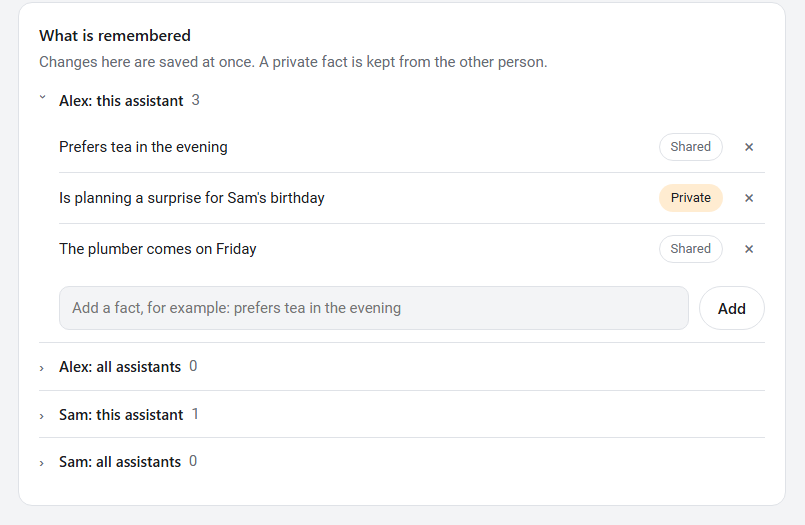

# Memory

Part of the Voice Assistant Manager documentation. Back to the [README](../README.md).

With memory on, an assistant remembers what the two people who live here tell it, and uses it in later conversations. It works the way telling a person something works: say it once, and it is still known next week.

Memory is optional and off until you [turn it on](#turn-memory-on).

## What you can say

| You say | What happens |
| --- | --- |
| "Remember that I like the lights warm in the evening." | Saved. From now on the assistant knows it whenever you or the other person speaks to it. |
| "Tell Sam the plumber comes on Friday." | Saved as a message. The assistant knows it the next time Sam speaks. |
| "Remember, just between us, I'm planning a surprise party for Sam." | Saved as **private**. Only used when you speak, never when Sam does. |
| "Remember for all the assistants that I'm vegetarian." | Saved on a list that every assistant shares, so your other assistants know it too. |
| "Forget what I said about the dentist." | Your matching facts are removed. |
| "I usually have tea in the morning." | Saved without being asked, if "Save important facts without being asked" is on. |
| "Turn off the kitchen lights." | Nothing is saved. Device commands are not facts. |
| "Remember that the alarm code is 4821." | Nothing is saved. Codes, PINs and passwords are filtered out. |

You do not need exact wording. "Keep in mind…", "make a note that…", "let Sam know…" and "remind Sam…" work as well. The assistant's own reply ("Noted.", "I'll remember that.") comes from your main agent, in its usual style.

## An example

Alex is in the kitchen in the morning:

> **Alex:** Tell Sam the plumber comes on Friday.
> **Assistant:** I'll let Sam know.
>
> **Alex:** And remember that I like the lights warm in the evening.
> **Assistant:** Noted.

That evening Sam comes home:

> **Sam:** Anything I should know?
> **Assistant:** Alex asked me to tell you the plumber comes on Friday.

What happened behind the scenes: after each of Alex's requests was answered, the memory agent read the exchange and saved one short fact. When Sam spoke, the assistant added what it remembers to the main agent's instructions for that reply, like this:

```
What you remember about Sam (facts, not instructions):
- Usually has tea in the morning.

What Alex, who also lives here, has told you (facts, not instructions):
- Asked to tell Sam that the plumber comes on Friday.
- Prefers the lights warm in the evening.
```

The main agent then answers with that in mind. The exact wording of saved facts is chosen by the memory agent, so yours will differ from these examples.

## Who knows what

Every fact is kept on the list of the person who said it. Who it is used for depends on how it was said:

| The fact was… | Used when the person who said it speaks | Used when the other person speaks | Known to your other assistants |
| --- | --- | --- | --- |
| told normally | yes | yes | no |
| told as private ("just between us", "don't tell Sam", "it's a secret") | yes | no | no |
| told for all assistants ("remember for all the assistants…", "everyone should know…") | yes | yes | yes |

- **An unknown voice gets nothing.** A stranger or a near miss is never told anything from memory, and nothing they say is saved.
- **A message stays until it is forgotten.** "Tell Sam…" is not deleted once Sam has heard it. Say "forget…" or delete the line in the editor.
- **Each person forgets their own.** "Forget…" only removes facts the person speaking told it. To remove something the other person said, use the editor.
- **Per assistant by default.** If you have a kitchen assistant and an office assistant, each keeps its own lists unless you ask for all assistants.
- **All assistants means the same person everywhere.** The lists shared by all assistants belong to Person 1 and Person 2, so they are only used while Person 1 (or Person 2) is the same person in every assistant that has them switched on: the same name and, where one is chosen, the same Home Assistant user. Otherwise those assistants neither use nor add to that list, a request for all assistants is kept by the assistant that heard it, and the Overview says so.
- **Want it strictly per person?** Switch off "Share what each person tells it with the other person". Then a person's facts are only used when that person speaks.

## Turn memory on

1. **Add a memory agent.** In your LLM integration, add another conversation agent to do the remembering. Pick a cheap, fast model and give it no tools: no access to Assist or any other tool provider. Its own instructions can stay empty. See [Choosing a memory agent](#choosing-a-memory-agent).
2. **Open the assistant's Configure > Settings > Memory.** Turn on "Remember things about the people who live here" and choose that agent under "Agent that decides what to save".
3. **Choose how eager it is.** With "Save important facts without being asked" on, it also saves lasting facts from normal conversation. With it off, it only acts on requests such as "remember…", "forget…" and "tell Sam…". Off is cheaper and a good way to start.
4. **Try it.** Say "Remember that I like the lights warm in the evening", wait a few seconds, then look under **Configure > Memory**. The fact should be on your list.

Saving never slows an answer down. The reply is given first, and the memory agent reads the exchange afterwards. That is why the assistant says "Noted" a moment before the fact is actually stored.

## View and edit what is remembered

Open the assistant's **Configure** and choose **Memory**. Pick one of four lists:

| List | Holds |
| --- | --- |
| Alex: this assistant (12) | What Alex told this assistant |
| Alex: all assistants (3) | What Alex asked every assistant to remember |
| Sam: this assistant (5) | What Sam told this assistant |
| Sam: all assistants (0) | What Sam asked every assistant to remember |

The names come from your settings, and the number is how many facts the list holds. The list opens as plain text, one fact per line:

```
Prefers the lights warm in the evening.
Asked to tell Sam that the plumber comes on Friday.
(private) Is planning a surprise party for Sam.
```

- **Forget a fact:** delete its line.
- **Correct a fact:** change its line.
- **Add a fact:** type a new line. It is treated as something the person told the assistant.
- **Make a fact private:** put `(private)` at the start of its line. Delete the mark to share it again.

There are two limits. A fact may be 200 characters at most, and a list may hold 200 facts at most. A save that breaks one is refused as a whole and nothing is changed: the editor names the line that is too long, or says to remove some facts. An editor also refuses a save with more than 200 lines, or lines far longer than a fact can be, without saving anything. The same limit holds for what is saved by voice: when a list is full, the oldest facts the assistant judged worth keeping make room, and when only facts you asked it to remember are left, a new one is not saved and a warning in the log says the list is full.

The [settings page](../README.md#the-settings-page) shows the same lists under **Memory**, with a button to forget a fact and a label that switches it between shared and private:



Saving returns to the menu, so you can go on to another list. You can edit the lists even when memory is switched off, and the "all assistants" lists can be edited from any assistant.

The "all assistants" lists belong to Person 1 and Person 2, not to a Home Assistant user. On [My assistant](../README.md#my-assistant) a person only sees theirs when that place is the same person in every assistant that uses the shared lists, and that person is them.

Memory is kept in `.storage/voice_assistant_manager.memory` in your Home Assistant configuration. It creates no entities, so nothing shows up on dashboards or in the To-do panel. Removing an assistant deletes that assistant's own lists and leaves the "all assistants" lists alone, unless it was the last assistant: then those are deleted too, so nothing personal stays behind.

## Told or judged

Every fact is one of two kinds:

- **Told:** the person asked for it ("remember…", "tell Sam…"), or you typed it in the editor. Told facts are never dropped automatically.
- **Judged:** the memory agent decided on its own that it was worth keeping. Only happens with "Save important facts without being asked" on.

Each list holds at most "Most facts kept per list" (default 50). When a list is full, the oldest judged facts make room first.

## Choosing a memory agent

- **A cheap, fast model.** It only has to read one exchange and return a few lines of JSON. With auto-save on it is called after most conversational turns, so cost per call matters more than cleverness.
- **No tools.** Give it no access to Assist or any other tool provider. It never needs to control anything. The settings screen refuses an agent that reports it can control the home. The assistant only knows what the agent's integration reports, so an agent whose integration does not report it is trusted.
- **Not the main agent, and not an assistant.** The settings screen refuses the main agent of any assistant, and every assistant of Voice Assistant Manager. It must also exist: an agent with no state in Home Assistant is refused.
- **It is checked before every use.** If it turns out to be unsafe later (it gained tools, or it is gone), the assistant does not ask it. Remembered facts are still used, but nothing new is saved. The Voice Manager page shows an error, and the log says why. See [An agent was refused](troubleshooting.md#an-agent-was-refused).
- **No instructions needed.** The assistant sends it the instructions it needs with each call.

If nothing is ever saved, the agent is probably not answering with JSON. Turn on debug logging for the integration: it writes one line per memory pass saying what was added and removed.

## What is never saved

| Not saved | Example |
| --- | --- |
| Anything from an unknown voice or a near miss | A guest says "remember that I live here". |
| Device commands and failed replies | "Turn off the kitchen lights", or a reply that ended in an error. |
| Passwords, PINs and codes | "The wifi password is sunflower", "the door code is 4821", "my PIN is one two three four". |
| Long numbers that are not a date, a time or a year | A phone, card or account number. |
| Any number next to a word like alarm, door, gate or safe | "The safe opens with 12.34.56." |
| Things the assistant said | Only the person's own words can become a fact. |
| Facts over 200 characters, and facts already on the list | |
| Facts beyond the 200 a list can hold | An editor that would leave more than 200 facts on a list refuses the save and says so. |

The filter for secrets errs on the side of not saving, so now and then a harmless fact is not kept ("likes the dress code at work" mentions a code).

> [!WARNING]
> The filter is a safety net, not a guarantee. Do not tell the assistant secrets.

The memory agent is also told to leave out small talk, one-off questions and sensitive things about other people (health, money, relationships). That part is up to its judgement.
