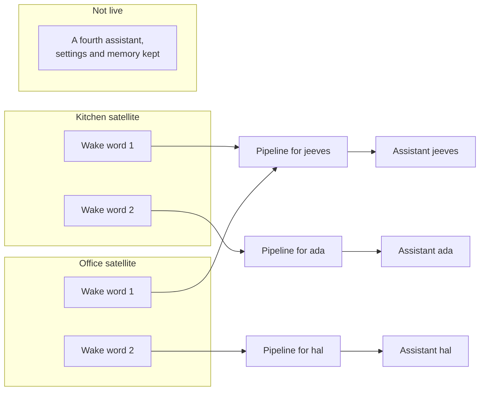

# More assistants than wake-word slots

Part of the Voice Assistant Manager documentation. Back to the [README](../README.md).

A satellite listens for a limited number of wake words, often two, and each one starts one assistant. You can still have more assistants than that and choose which ones are live.

Here `jeeves` is live on both satellites, `ada` only in the kitchen and `hal` only in the office. The fourth assistant is on no satellite at the moment. Swapping it in means giving a wake word its pipeline. It is ready as it was.

**Each assistant is its own entry of this integration**, with its own settings, its own memory and its own voice assistant pipeline. Which assistants are live is chosen on each satellite, where every wake word is given a pipeline. It is not stored in the assistant. Swapping an assistant out therefore loses nothing: the assistant stays as it is and simply is not called until you swap it back in.

To add another assistant, add the integration again with a new name and a main agent, fill in its settings, and make a voice assistant pipeline that uses it. See [Set up](../README.md#set-up).

**Swap per satellite, and change the wake word with the pipeline.** An assistant can be live on some satellites and not on others, so the choice is made for each satellite. Where the wake word is the assistant's name, change the satellite's wake word together with the pipeline, or the old wake word calls the new assistant. A Home Assistant scene per line-up that sets both, for the satellites it concerns, is the simplest way to switch with one tap. How these settings are named depends on your satellites, so Voice Assistant Manager does not do the switching itself.

**What does not follow a swap:**

- **Calendars.** An assistant keeps announcing the calendars on its list while it is on no satellite. Keep calendar lists on an assistant that is always live.
- **Reminders.** A reminder is spoken by the assistant that took it, also after that assistant is swapped out.
- **Memory.** Each assistant keeps its own memory lists. Facts saved for all assistants are shared, so every assistant knows those, live or not.

**Make a new assistant known to your own scripts.** Wherever your scripts list assistants by name, add the new one, using its [assistant name](reminders.md#assistant-names). The usual place is the script that speaks reminders, with its voice per assistant. If the new assistant is missing there, its reminders are spoken in whatever voice that script falls back to, typically the satellite's default.
