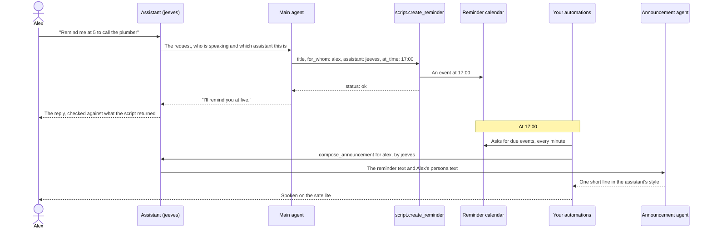

# Reminders

Part of the Voice Assistant Manager documentation. Back to the [README](../README.md).

Voice Assistant Manager does not keep reminders itself. Home Assistant does that, with a script the main agent can call. What Voice Assistant Manager adds is everything around it, so reminders work properly with more than one person and more than one assistant:

- **It tells the main agent who is asking, and which assistant it is.** "Remind me" has to become a reminder for the right person, spoken later by the same assistant. On every turn the main agent is told who is speaking and which values to pass.
- **It keeps reminders and memory apart.** "Remind me at 5 to call the plumber" is a reminder. "Remember that I like jazz" is a memory. Neither ends up in the other.
- **It guards against false confirmations.** If the main agent says a reminder is set without actually setting it, the assistant replaces the reply with an honest one, where it can tell.
- **It words spoken reminders in the assistant's style.** When a reminder is due, Home Assistant can ask for one short line in the persona of the assistant that took the reminder.

Reminders are optional and off until you [turn them on](#turn-reminders-on).

The examples below use two people, Alex and Sam, and two assistants that go by the assistant names `jeeves` and `ada`.

## How a reminder travels



The assistant is involved twice: when the reminder is set, and, if you want the spoken line in the assistant's style, when it is due. Everything in between is Home Assistant.

## Reminder phrases

| You say | What happens |
| --- | --- |
| "Remind me at 5 pm to call the plumber." | A reminder for you. The main agent calls `create_reminder`. Nothing is saved to memory. |
| "Remind us in 20 minutes to check the oven." | A reminder for the household. |
| "Remind me every weekday at 7 to stretch." | A repeating reminder. See [Repeating reminders](#repeating-reminders). |
| "Stop reminding me to take my pills." | Cancels that reminder, a repeating one as a whole. See [Cancelling a reminder](#cancelling-a-reminder). Nothing is saved to memory. |
| "Remind Sam at 6 to call the plumber." | A reminder for Sam. |
| "Remember that I like the lights warm in the evening." | A memory, never a reminder. See [Memory](memory.md). |
| "Remind Sam the plumber comes on Friday." | No time to be alerted at, so it is a message for Sam that memory keeps. |
| "Remember to buy milk." | Unclear, so the assistant asks whether you want a reminder, and when. Nothing is saved from this request. If you want it remembered and not a reminder, say "remember that…". |
| "Remember to always use the blue towels." | A standing preference, so a memory. The same goes for "remember to never…", "remember to call me…" and "remember to use…". |

A stranger asking for a reminder gets the usual refusal. Their request never reaches the main agent or the script.

## What Home Assistant has to provide

Voice Assistant Manager expects these to exist. It does not create them.

**A script named `script.create_reminder`, exposed to Assist**, so the main agent can call it as a tool. The assistant depends on three things about it: the `for_whom` field, the `assistant` field, and the `status` it returns. The assistant tells the main agent what to pass for the first two.

| Field | Value |
| --- | --- |
| `for_whom` | `alex`, `sam` or `household`: the name of Person 1 or Person 2 from the assistant's settings in lower case, or `household` for both. |
| `assistant` | The assistant that took the reminder, for example `jeeves` or `ada`. See [Assistant names](#assistant-names). |

It must return a response with `status` set to `ok` or `error`. On an error, its `message` says what to tell the person. The assistant relies on that `status` to know whether a reminder was really set.

The other fields are between your script and the main agent, which reads them from the script's own description. These work well:

| Field | Value |
| --- | --- |
| `title` | What to be reminded of. |
| `announce` | Whether to speak the reminder when it is due. A boolean, `true` by default. |
| `in_minutes` | For "in 20 minutes" or "in an hour and a half". |
| `at_time` | A time on the clock, `HH:MM`, local time. |
| `on_day` | `today`, `tomorrow`, a weekday name, or `MM-DD`. With no year, the script takes the next time that day comes round. |

**Do not ask the main agent for a full date.** An earlier version of this script had one field for the date and time (`YYYY-MM-DD HH:MM:SS`). A language model does not know today's date, and it passed a date two years in the past. Take "in so many minutes", a time on the clock and a day as above, and let the script work out the date. It also helps to:

- say in the script's description that it is not the memory feature, and that the date must never be guessed;
- have the error `message` name the fields to pass and give the current time, so the main agent can try again;
- return what was set next to `status`, such as the reminder's text and when it is due, so the main agent can confirm it correctly.

> [!TIP]
> [`examples/create_reminder.yaml`](../examples/create_reminder.yaml) is a complete script that works this way. It writes to a Local Calendar per person, works out the date from `in_minutes`, `at_time` and `on_day`, and returns `status`, `message` and what was set. Change the names in it to your own.

## Repeating reminders

Home Assistant's `calendar.create_event` action cannot make an event repeat; only the calendar page can. So for a reminder that repeats, the example script asks this integration's `voice_assistant_manager.create_reminder_event` action, which adds a repeating event to a Local Calendar the same way the calendar page does. Your automation that checks for due reminders needs no change: `calendar.get_events` lists every time a repeating event comes round.

The example `create_reminder` script takes these fields for it, next to `at_time` (the time of day) and `on_day` (when it starts):

| Field | Value |
| --- | --- |
| `repeat` | `daily`, `weekdays`, `weekends`, `weekly`, `monthly` or `yearly`. Needs `at_time`, not `in_minutes`. |
| `repeat_on` | With `weekly`, the weekdays, for example `monday, thursday`. |
| `repeat_every` | `2` for every other day, week, month or year. |
| `repeat_times` | How many times in all. Leave out for no end. |
| `repeat_until` | The last day, `MM-DD`. Leave out for no end. Not with `repeat_times`. |

With `weekdays`, `weekends` or `repeat_on`, the first reminder moves to the first of those days, at the same time. A monthly reminder on the 31st skips months without one. The script returns when the first reminder is due. The assistant tells the main agent how to use these fields, and never to work out dates itself.

## Cancelling a reminder

"Stop reminding me to take my pills" or "cancel the bins reminder" calls a second script, `script.cancel_reminder`, exposed to Assist like `create_reminder`. It passes the title, or a word from it, and `for_whom`, and uses this integration's `voice_assistant_manager.cancel_reminder_event` action, since Home Assistant has no action that deletes an event. It looks in both of the person's reminder calendars, and removes a repeating reminder as a whole. When several reminders match ("feed the cat", "feed the fish"), nothing is removed: the answer lists them, and the assistant asks which one.

> [!TIP]
> [`examples/cancel_reminder.yaml`](../examples/cancel_reminder.yaml) is a complete script. Use the same names in it as in `create_reminder`.

**A person can cancel their own reminders and the household's, never the other person's.** The script passes `for_whom` to the action, and the action compares it with the person speaking, which it takes from the assistant and not from the main agent (as for [looking up](#asking-which-reminders-there-are)). A request through an assistant from a script that does not pass `for_whom` is refused, so update `cancel_reminder` from the example. Outside a conversation (an automation), a call that names a person is refused and one that names `household` or nobody works as before.

Both actions refuse a person who may not control the calendar, as the calendar page does. Automations and scripts without a person are allowed.

**The main agent can cancel reminders** under Settings > Reminders turns this on or off for each assistant, on by default. Off, the main agent is told it cannot cancel reminders and to point to the reminder calendar. That is an instruction, not a lock: to make sure no assistant can cancel, also stop exposing `script.cancel_reminder` to Assist.

**A script that speaks due reminders**, for example `script.reminder_announce`, using `assist_satellite.announce` in the voice of the assistant that took the reminder. To have the reminder worded in that assistant's style too, it first calls this integration's action and falls back to plain text when that returns nothing:

```yaml
- action: voice_assistant_manager.compose_announcement
  data:
    satellite: assist_satellite.kitchen_satellite
    kind: reminder
    text: Call the plumber about the boiler at 5 pm
    recipient: alex
    assistant: jeeves
  response_variable: line
  continue_on_error: true
- action: assist_satellite.announce
  target:
    entity_id: assist_satellite.kitchen_satellite
  data:
    message: >-
      {{ line.text if line is defined and line.text
         else 'Reminder for Alex: call the plumber about the boiler at 5 pm.' }}
```

A switch such as `input_boolean.reminders_persona_phrasing` is a good way to turn that first step on and off.

## Asking which reminders there are

"What reminders are there on Wednesday?", "do we have a reminder for charging the car?" or "list my reminders" calls a third script, `script.list_reminders`, exposed to Assist like the other two. It uses this integration's `voice_assistant_manager.list_reminder_events` action, which changes nothing. The main agent can pass:

| Field | Meaning |
| --- | --- |
| `keywords` | Words that must be in the reminder's title or notes. "charging" also finds "Charge the car". Left out: every reminder. |
| `on_day` | `today`, `tomorrow`, a weekday name or `MM-DD`. Left out: everything coming up, two years ahead. |
| `until_day` | With `on_day`, the last day of a stretch of days. |

Each reminder comes back once, with its settings as they are in the calendar: title, who it is for, when it is next due, how it repeats ("every weekday", "every 2 weeks on Friday"), when that ends, the calendar rule itself, how long it lasts, whether it is spoken, and the assistant that took it. A question in looser words ("anything about the car?") works because the main agent can ask for all of them and pick what is relevant.

**A person sees their own reminders and the household's, never the other person's.** The main agent does not say whose reminders to show, and cannot: the assistant notes who is speaking on each turn, and the action goes by that. When it is not known who is speaking (the action is called outside a turn, say from an automation), only the household's reminders are shown. So the script lists every person's calendars under that person's name, and the action leaves out what the person speaking may not see.

> [!TIP]
> [`examples/list_reminders.yaml`](../examples/list_reminders.yaml) is a complete script. Use the same names in it as in `create_reminder`.

The main agent is told to answer such questions only from what the script returns. When it answers without looking, it is asked once more; if it still has not looked, the person hears "I could not look up the reminders. Please ask me again." (see [No false confirmations](#no-false-confirmations)).

## How one setup does it

This is how the Home Assistant side is built in the setup this integration was developed against. None of it is part of the integration, and yours can differ. It is here as a worked example.

<details>
<summary>Show the worked example</summary>

**Where reminders live.** Six [Local Calendars](https://www.home-assistant.io/integrations/local_calendar/), two for each owner (Alex, Sam and the household): "Alex Reminders", which only reaches the phone, and "Alex Reminders (announce)", which reaches the phone and is spoken. Choosing the calendar is choosing whether the reminder is spoken. `script.create_reminder` writes an event of five minutes and puts `assistant: jeeves` in its description.

**What watches them.**

- An automation runs every minute. It asks all six calendars for the events since its last check with `calendar.get_events`, and fires an event `reminder_due` with the calendar, the summary, whether it is all day, and the assistant. Home Assistant's calendar trigger is not used, because it missed events created shortly before their start. The time of the last check is kept in an `input_datetime`, so a restart catches up.
- A second automation handles `reminder_due`. It always sends a phone notification with the buttons Done and Snooze 10 min, and repeats it a set number of times if nothing is tapped. For an "(announce)" calendar it also calls the announce script. Snooze creates a new event ten minutes later on the same calendar. All-day reminders wait until quiet hours are over.

**The scripts.**

- **The announce script** speaks only outside quiet hours and when the owner is home. It uses the satellite in the room the person is in when that is known, and all satellites otherwise. It speaks in the voice of the assistant that took the reminder, by giving `assist_satellite.announce` a `media_id` of the form `media-source://tts/<engine>?message=...&voice=<voice>`, from a small map of engine and voice per assistant. For the wording it calls `compose_announcement`, unless it is handed a ready-made `line`.
- **The notify script** is the one place that maps a person to their phone.
- **The calendar script** is the one chosen under Settings > Calendars for [calendar announcements](calendars.md). It sends a plain phone notification and passes the `line` on to the announce script.

</details>

> [!CAUTION]
> **Reminder calendars and the assistant's calendar list do not mix.** Reminder calendars are announced by your own automations, never by the assistant's own calendar list. That list is for other calendars only. Listing a reminder calendar there announces every reminder twice.

## The compose_announcement action

`voice_assistant_manager.compose_announcement` writes one short spoken line and returns it. It does not speak.

**Who can call it.** Automations, scripts started by an automation, and the assistants' own [calendar announcements](calendars.md) keep working: they run without a user. An administrator can call it too, from Developer tools for example. A user who is not an administrator is refused (`Unauthorized`), which also means that if such a user runs your announce script by hand from the Home Assistant app, the script stops at this action. Run it from an automation, or as an administrator.

| Field | Value |
| --- | --- |
| `satellite` | The `assist_satellite` entity that will speak. |
| `kind` | `reminder`. Nothing else is supported yet. |
| `text` | What the reminder says. |
| `recipient` | `alex`, `sam` or `household`, as for `for_whom` above. |
| `assistant` | Optional. The assistant that took the reminder, by its [assistant name](#assistant-names). |

It answers with `{"text": "<at most two sentences>"}`, for example:

```yaml
text: "Alex, a gentle nudge: call the plumber about the boiler at 5 pm."
```

**Which assistant writes it.** The line has to match the voice it is spoken in, so:

1. If `assistant` is given, the assistant that goes by that name writes it. If no assistant does (the name belongs to a Home Assistant voice assistant that does not use one, or two assistants share it), the answer is empty text. The satellite is not used as a second guess.
2. Only if `assistant` is empty, the satellite decides: its **primary** voice assistant pipeline (on EchoLocal devices the `select.<device>_assistant` entity, not `…_assistant_2`, which is the second wake word) is looked up, and if its conversation agent is one of the assistants, that assistant writes it.

**How it is written.** The assistant's announcement agent, which has no tools, gets the persona text you wrote for the recipient (Person 1 or Person 2; for `household` both names and no single persona) and an instruction to deliver the reminder in character, content intact, in at most two sentences and without asking anything.

It returns `{"text": ""}`, so your script can fall back to plain text, when:

- no assistant matches, as described above
- the recipient is not Person 1's or Person 2's name, or `household`
- the assistant has no announcement agent, or that agent is the main agent, an assistant, Home Assistant's built-in agent, or an agent that reports it can control the home
- the agent fails, answers with nothing or rambles on, or takes longer than 6 seconds

What it never does: it never calls the main agent or any tool, never goes through the assistant's own conversation handling (so no speaker check, and no refusal line), never treats the reminder text as an instruction, never adds anything to the conversation history, and never saves anything to memory.

**Showing who speaks.** When a line was written and the satellite can show which assistant is talking (see [Chat show](chat-show.md#showing-who-speaks)), the writing assistant is chosen for the satellite's next announcement. The device keeps that choice for 30 seconds, so announce the line straight after. Nothing happens on other satellites, or when **Show which assistant is speaking** is off on the Voice Manager page.

## The prepare_announcement action

`voice_assistant_manager.prepare_announcement` chooses the character for a satellite's next announcement, for announcements that do not go through `compose_announcement`, such as [calendar announcements](calendars.md#what-your-script-receives). Call it just before `assist_satellite.announce`. Who can call it is the same as for `compose_announcement`.

| Field | Value |
| --- | --- |
| `satellite` | The `assist_satellite` entity that will speak. |
| `assistant` | Optional. The assistant that will speak, by its [assistant name](#assistant-names). Empty or unknown shows the device's default character. |

It does nothing on a satellite that cannot show a character, or when **Show which assistant is speaking** is off on the Voice Manager page.

## Assistant names

Each assistant goes by one assistant name in reminders. By default it is the first word of the assistant's name in lower case: an assistant called "Jeeves (by speaker)" is `jeeves`. Set **Assistant name** under Configure > Settings > Reminders if you want something else.

That name is used in two places, and they must agree with your Home Assistant scripts:

- the main agent is told to pass it as `assistant` when it calls `create_reminder`
- `compose_announcement` uses it to find the assistant when `assistant` is given

## My assistant

On the [My assistant](../README.md#my-assistant) page, Alex and Sam see their own reminders and the household's for the next 30 days, add them and delete them. Voice Assistant Manager stores nothing for this.

**Where it looks.** An administrator lists the calendars under Settings > Reminders: **Reminder calendars of Person 1**, **of Person 2** and **of the household**. For Alex, My assistant reads Alex's calendars and the household's, never Sam's. Each reminder shows the name of its calendar, so "(announce)" is visible. A calendar that cannot be read is named in the list. A personal calendar may belong to one Home Assistant user only, across all assistants, and may not also be a household calendar. A personal list needs that person's Home Assistant user.

**Adding.** The form asks for what to be reminded of, "For me" or "For the household", whether to speak it when it is due, and either a number of minutes or a time and day. The page calls `script.create_reminder` with `title`, `for_whom`, `assistant`, `announce`, and `in_minutes` or `at_time` with `on_day`, the fields described [above](#what-home-assistant-has-to-provide). `for_whom` is worked out on the server: the person's own lower-case name, or `household`. The message the script returns is shown as it is. The page never writes to a calendar itself, so your script decides which calendar is used. If the script does not exist, the form is replaced by a line saying so.

**Deleting.** A reminder can be deleted only when it is in one of the person's own or the household's calendars, and only when that calendar allows deleting.

> [!NOTE]
> This does not hide calendars from Home Assistant itself. See the note under [My assistant](../README.md#my-assistant).

## Turn reminders on

1. **Set up the Home Assistant side** as described above, and expose `script.create_reminder` to Assist.
2. **Check the names.** `for_whom` and `recipient` use the names of Person 1 and Person 2 from the assistant's settings in lower case. If Person 1 is called "Alex" there, your script must accept `alex`. `assistant` uses each assistant's [assistant name](#assistant-names).
3. **Open the assistant's Configure > Settings > Reminders** and turn on "The main agent can set reminders".
4. **Choose who writes the spoken lines.** "Announcement agent (no tools)" must be an agent with no tools, in the same style as your main agent. An agent with Assist or another way to control the home turned on is refused. If you leave it empty, the agent that writes refusals for unknown voices is used. With neither, announcements stay plain text.
5. **Try it.** Say "Remind me in two minutes to stretch" and check that a reminder appears in Home Assistant, for you and with the right assistant. Then run the action from **Developer tools > Actions** and look at the text it returns.
6. **Turn on the persona wording** in Home Assistant last (for example `input_boolean.reminders_persona_phrasing`), once the plain reminders work.

## No false confirmations

A language model can say "your reminder is set" without having called the tool. Two things guard against that:

- The main agent is told it may only confirm a reminder after `create_reminder` returned status `ok` in that turn, and must pass on the message of an error.
- After each reply the assistant looks at the tools that were actually called in that turn. If the reply says a reminder is set ("your reminder is set", "I'll remind you at five") and `create_reminder` did not return `ok`, the reply is replaced by "I could not set that reminder. Please ask me again." You can change that line in the settings.

The same goes for cancelling: a reply that says a reminder is cancelled or removed when `cancel_reminder` did not return `ok` is replaced by "I could not cancel that reminder. Please ask me again." A reply after a cancellation is never taken for a reminder that was set, even when it says when the reminder was set for.

And for looking up: a reply that says which reminders there are, or that there are none, when `list_reminders` did not return `ok` is replaced by "I could not look up the reminders. Please ask me again." A reply after a look-up is never taken for a false confirmation, although it says when a reminder is set for.

**One more try first.** When the reply says a reminder is set or cancelled and the tool was not called at all, the main agent is asked once more, with a note that it did not call the tool. If it then does, the history reads as if that had been its first answer. Only when the reminder is still not set does the honest line follow. The same second try is made for any other reply that says something was done ("I've turned on the lights") with no tool call; if the second answer still says so without a tool call, or the second try fails, the assistant says "I could not do that. Please ask me again.": a refusal is better than a confirmation of something that did not happen.

**Taken back out loud.** A longer reply streams to the voice while it is being written, so the voice may already be saying "I've set a reminder" when the check sees it. The second try runs meanwhile. If it sets the reminder, nothing more is said, because what was spoken is now true. If it does not, the voice follows on at once: "Sorry, scratch that, I spoke too soon. I could not set that reminder. Please ask me again." If the second answer says something else, such as why it cannot, the voice says "Sorry, let me put that right." and then that answer. A short reply the voice has not started on is simply spoken as corrected.

This is a safety net, not a guarantee. It only reacts to a reply that clearly claims a reminder, so a vaguer false confirmation ("Okay, five o'clock it is.") gets through. A reply that asks something back, reports a failure, or is about something else ("I've set a timer") is left alone, and so is "I'll remind Sam" after a message for Sam with no time.
